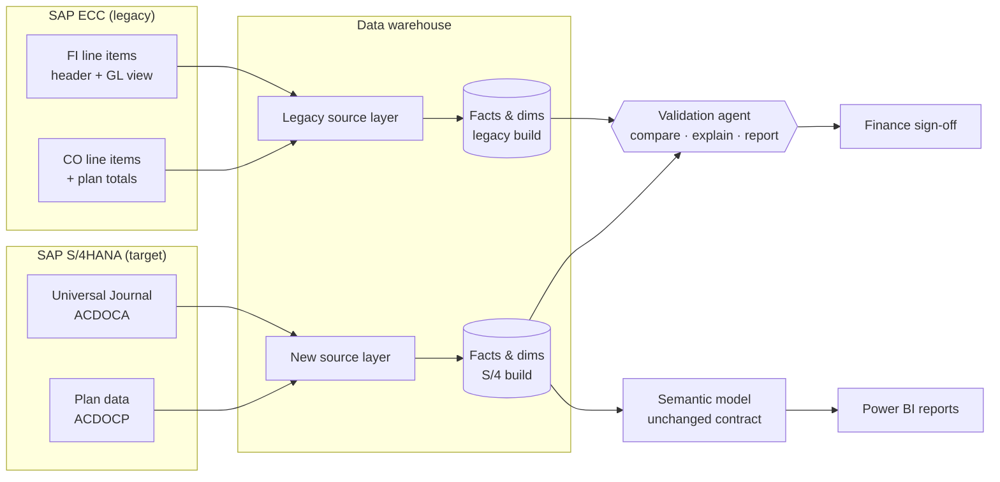

# SAP S/4HANA Finance Reporting Migration & AI Validation Agent

A practical, vendor-neutral playbook for migrating **finance BI reporting** from SAP ECC to SAP S/4HANA, and a working **validation agent** that reconciles the legacy and new data models automatically and explains the differences it finds.

> **Goal:** on the day after go-live, the CFO opens the same P&L dashboard and sees the same numbers. The migration is judged on trust, not on tables.

---

## Who this is for

- BI and data engineers who own finance data models on SAP sources
- Finance / controlling teams who need to sign off migrated numbers
- Architects planning the reporting stream of an S/4HANA programme

The examples use **Snowflake** and **Power BI**, but the approach works on any warehouse (Azure SQL, Synapse, Fabric, Databricks) and BI tool.

---

## The approach in one picture



**Key idea:** keep the semantic layer and reports stable, rebuild only the source layer underneath, run both builds in parallel, and let an agent prove they match.

---

## Repository map

| Path | What it contains |
|---|---|
| [`docs/01-migration-approach.md`](docs/01-migration-approach.md) | The six phases end to end: inventory → design → build → parallel run → sign-off → hypercare |
| [`docs/02-reporting-migration-playbook.md`](docs/02-reporting-migration-playbook.md) | How to rebuild the source layer: ECC → S/4HANA table and field mapping, design rules, pitfalls |
| [`docs/03-validation-agent.md`](docs/03-validation-agent.md) | Step-by-step: how to design, build, schedule and govern the validation agent |
| [`docs/04-ai-assisted-migration.md`](docs/04-ai-assisted-migration.md) | Where AI helps (code conversion, documentation, test cases, explanations) and the guardrails |
| [`docs/05-checklists.md`](docs/05-checklists.md) | Cut-over checklist and finance sign-off template |
| [`config/validation_rules.yml`](config/validation_rules.yml) | Declarative reconciliation rules: grain, measures, tolerances |
| [`agent/validation_agent.py`](agent/validation_agent.py) | The agent: generates SQL from rules, reconciles, classifies and explains mismatches, writes a report |
| [`sql/`](sql/) | Reference reconciliation SQL and the results table DDL |
| [`demo/`](demo/) | Sample legacy vs. S/4 data with deliberately planted issues |
| [`ci/`](ci/) | GitHub Actions template for nightly runs |

---

## Quick start (runs locally in under a minute)

```bash
cd s4hana-reporting-migration
pip install -r requirements.txt
python agent/validation_agent.py --config config/validation_rules.yml --demo
```

The demo loads sample data into an in-memory DuckDB database, runs every rule, and writes `output/validation_report.md`. The sample data contains planted issues (missing special-period postings, a sign flip, a currency difference, a mapping change), and the agent finds and explains each one.

To run against Snowflake, set the connection environment variables described in [`docs/03-validation-agent.md`](docs/03-validation-agent.md#step-6-connect-to-the-warehouse) and drop `--demo`.

To get AI-written explanations in addition to the built-in rule-based ones, set `LLM_API_KEY` (see [`docs/04-ai-assisted-migration.md`](docs/04-ai-assisted-migration.md)). Only aggregated mismatch summaries are sent, never line-item data.

---

## Principles

1. **Swap the foundation, not the house.** Reports and KPI definitions stay identical for users.
2. **Reconcile by design.** Every fact has a declared grain and a control total it must match.
3. **Automate the checking, not the judgement.** The agent finds and explains; Finance decides.
4. **Every difference gets a root cause:** data, mapping, or a genuine process change.
5. **Trust is the go-live criterion.** No sign-off, no switch-off of the legacy model.

---

## Author

**Arunraj Selvaraj**, Finance Data & BI. 14+ years across SAP Finance, data engineering and analytics.

Feedback and pull requests are welcome.

## License

MIT, see [LICENSE](LICENSE).
