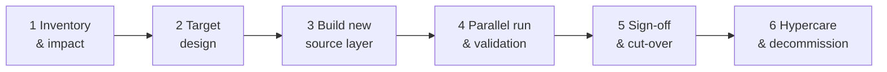

# 01 · Migration approach: six phases end to end

A finance reporting migration runs as its own workstream inside the S/4HANA programme. It starts early (during the ERP design) and ends only when Finance has signed off and the legacy build is switched off.

---

## Phase 1: Inventory & impact analysis

**Goal:** know exactly what will break before anything moves.

| Step | How | Output |
|---|---|---|
| 1.1 List every consumer | Export all Power BI reports, datasets, Excel connections, scheduled extracts and their owners. Include usage (views in the last 90 days) so you can retire what nobody uses. | Report inventory |
| 1.2 Trace lineage to SAP | For each dataset, trace semantic model → warehouse view → fact/dim table → SAP source table and field. | Lineage map |
| 1.3 Classify impact | Per source object: *unchanged* (master data such as company codes, cost centers), *re-pointed* (same meaning, new table, e.g. FI/CO line items → Universal Journal), *redesigned* (logic changes, e.g. costing-based CO-PA → margin analysis), *retired*. | Impact matrix |
| 1.4 Capture the KPI contract | For every KPI: definition, owner, grain, filters, sign convention, currency. This becomes the contract the new build must honour. | KPI dictionary |
| 1.5 Agree scope & priorities | With Finance, rank by criticality: statutory and CFO reporting first, then management reporting, then self-service. | Prioritised backlog |

**Tip:** use AI to draft lineage and KPI documentation from existing SQL and DAX (see [04](04-ai-assisted-migration.md)). Review it, but don't write it from scratch.

---

## Phase 2: Target design

**Goal:** decide how the new source layer produces the *same* facts and dimensions.

- **Keep the contract stable.** Facts, dimensions, column names and keys that the semantic model uses stay identical. Only the views or tables *underneath* change.
- **Design per fact, not per table.** Example: `fact_gl_actual` in ECC was built from FI header + FI line + new-GL line items; in S/4HANA it reads from the Universal Journal. Same output columns, new source.
- **Decide on the hard cases up front:**
  - Profitability: costing-based CO-PA vs. account-based margin analysis (values may legitimately differ, so agree the target with Controlling)
  - Plan data: where plan comes from after go-live (S/4 plan table, SAC, external tool)
  - Historical data: migrate history into the new build, or union legacy history + new actuals with a cut-over date
  - Currencies: map ECC currency fields to S/4 currency types explicitly
- **Define the reconciliation grains** for each fact (see [03](03-validation-agent.md)). If you can't say how you will prove a fact matches, the design isn't finished.

Output: target design document, field mapping (see [02](02-reporting-migration-playbook.md)), reconciliation rules.

---

## Phase 3: Build the new source layer

- Build in a **separate schema** (for example `S4_STAGE`, `S4_CORE`) so both builds run side by side.
- Use the same transformation framework, naming and tests as the legacy build.
- Version everything in Git; deploy via CI/CD to DEV → QA → PROD.
- Write the reconciliation rules **at the same time** as the transformations, not after.
- Unit-test edge cases: reversals, intercompany, special periods 13–16, multi-currency, zero-value lines.

---

## Phase 4: Parallel run & validation

**Goal:** prove the new build matches, period by period.

1. Load the same periods into both builds (at least 2–3 closed periods plus one live month-end).
2. Run the **validation agent** nightly and after each load.
3. Triage every mismatch into one of three buckets:
   - **Data issue:** missing or extra data → fix the load
   - **Mapping issue:** wrong field/derivation → fix the transformation
   - **Expected change:** the business process changed in S/4HANA (e.g. profit center now derived on every line) → document and get Finance approval
4. Track the open-issue count per period; the goal is zero unexplained differences.

---

## Phase 5: Sign-off & cut-over

- Finance reviews the validation report for each critical KPI and signs the template in [05-checklists.md](05-checklists.md).
- Switch the semantic model's source from the legacy views to the new views (one change, because the contract is identical).
- Freeze the legacy build read-only; keep it for at least one quarter-end close as a fallback.

---

## Phase 6: Hypercare & decommission

- Keep the agent running against the frozen legacy build through the first quarter-end close.
- Hold a daily stand-up with Finance during the first close after go-live.
- Decommission the legacy pipelines once a quarter-end has closed without unexplained differences.
- Keep the agent: re-point it to compare the warehouse against SAP control totals as a permanent data-quality check.

---

## Roles (RACI)

| Activity | BI / data team | Finance & Controlling | IT / SAP team | Management |
|---|---|---|---|---|
| Inventory & lineage | **R/A** | C | C | I |
| KPI contract | R | **A** | I | C |
| Target design & mapping | **R/A** | C | C | I |
| Build & tests | **R/A** | I | C | I |
| Parallel run triage | **R** | C | C | I |
| Expected-change approval | C | **A** | C | I |
| Sign-off | R | **A** | I | I |
| Cut-over | **R/A** | C | C | I |
