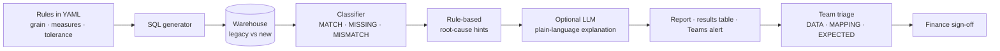

# 03 · Building the validation agent, step by step

The validation agent replaces month-end manual checking. It compares the legacy and new builds at every agreed grain, classifies each difference, suggests the likely root cause, and produces a report that Finance can sign off.



It is an *agent* in the practical sense: it runs on its own, decides which checks fail, reasons about likely causes, and reports. It never changes data and never signs anything off.

---

## Step 1: Define what "the same" means

Before writing code, agree with Finance and Controlling:

| Decision | Example |
|---|---|
| Facts in scope | `fact_gl_actual`, `fact_plan`, `fact_profitability` |
| Grains to reconcile | company × period; company × period × account; × profit center; × cost center |
| Measures | amount in group currency, amount in local currency, quantity, line count |
| Tolerances | 0.01 per row for amounts (rounding); 0 for line counts |
| Severity | *critical* (blocks sign-off): totals by company/period/account; *warning*: profit center, cost center detail |
| Periods | at least 2–3 closed periods plus the next live month-end, including special periods 13–16 |

Start coarse (company × period) and add finer grains. A coarse rule tells you *that* something is wrong; finer rules tell you *where*.

## Step 2: Write the rules as configuration

Rules live in [`config/validation_rules.yml`](../config/validation_rules.yml), versioned in Git and reviewed like code. Adding a check is one YAML block, not new code:

```yaml
- id: gl_total_by_account
  type: reconcile
  legacy_table: legacy.fact_gl_actual
  new_table: s4.fact_gl_actual
  grain: [company_code, fiscal_year, period, gl_account]
  measures: [amount_gc]
  filter: "fiscal_year = {fiscal_year}"
```

Two rule types are included:
- **reconcile:** aggregate both builds at the grain and compare measures and line counts
- **orphan_keys:** find fact keys with no matching dimension member (they show up as "blank" in reports)

## Step 3: Generate the reconciliation SQL

For each rule the agent generates one query: each side is aggregated in an inline subquery and the two are joined with a `FULL OUTER JOIN`, so rows missing on either side are kept. See [`sql/01_recon_gl_by_account.sql`](../sql/01_recon_gl_by_account.sql) for the generated pattern.

Table and column names are validated against a strict identifier pattern before they're used, so a typo in the config can't turn into arbitrary SQL.

## Step 4: Classify every row

| Status | Meaning |
|---|---|
| `MATCH` | Within tolerance |
| `MISSING_IN_NEW` | Exists in legacy only (data not loaded, filter too narrow) |
| `MISSING_IN_LEGACY` | Exists in the new build only (new accounts, new derivations, duplicates) |
| `AMOUNT_MISMATCH` | Both exist, amounts differ beyond tolerance |
| `COUNT_MISMATCH` | Amounts match, line counts don't (granularity or join issue) |
| `ORPHAN_KEY` | Fact key missing from its dimension |

## Step 5: Explain likely root causes

This is where the agent saves the most time. It first applies **rule-based detectors** that recognise the classic migration bugs from patterns in the differences:

| Pattern in the data | Finding |
|---|---|
| All rows missing in the new build are in periods ≥ 13 | Special periods not extracted |
| New amount = −1 × legacy amount | Debit/credit sign applied twice |
| new / legacy is a constant ratio per company | Wrong currency field |
| new / legacy ≈ 2 | Duplicate lines: non-leading ledger or fan-out join |
| Differences net to zero within a parent group | Values moved between members (derivation/mapping change) |
| Same amount, different line count | Granularity change |

Then, **optionally**, it sends the aggregated findings to an LLM, which writes a short plain-language explanation for controllers and classifies each issue as DATA, MAPPING or EXPECTED CHANGE (see [04](04-ai-assisted-migration.md) for guardrails). Only grain-level aggregates and rule metadata are sent, never line items, customer or employee data.

The run never fails because the LLM is unavailable; the rule-based findings always appear.

## Step 6: Connect to the warehouse

The demo uses DuckDB in memory. For Snowflake:

```bash
pip install snowflake-connector-python
export SNOWFLAKE_ACCOUNT=xy12345.eu-central-1
export SNOWFLAKE_USER=SVC_VALIDATION_AGENT
export SNOWFLAKE_AUTHENTICATOR=SNOWFLAKE_JWT     # key-pair auth recommended for service users
export SNOWFLAKE_WAREHOUSE=WH_QA_XS
export SNOWFLAKE_DATABASE=FINANCE_DWH
export SNOWFLAKE_ROLE=QA_READONLY
export RESULTS_TABLE=qa.validation_results       # optional audit trail
python agent/validation_agent.py --config config/validation_rules.yml
```

Use a **read-only service role** on the legacy and new schemas plus insert rights on `qa.validation_results` only (DDL in [`sql/00_results_table.sql`](../sql/00_results_table.sql)). The same pattern works for Azure SQL / Synapse / Fabric by swapping the connector in the `Warehouse` class.

## Step 7: Schedule it

Run the agent after every load of either build. Options:

- **GitHub Actions / Azure DevOps pipeline:** nightly schedule; the exit code is 1 when a critical rule fails, so the pipeline turns red (example in [`ci/nightly-validation.yml`](../ci/nightly-validation.yml), a template to copy into `.github/workflows/`)
- **Azure Data Factory:** add a final activity to the load pipeline that runs the agent (e.g. an Azure Function or batch job)
- **Snowflake:** a Task that calls a Python stored procedure wrapping the same logic

Set `TEAMS_WEBHOOK_URL` to post a one-line summary to the migration channel after each run.

## Step 8: Triage and track

1. The BI team reviews new mismatches daily during the parallel run.
2. Each one gets a triage value in `qa.validation_results`: **DATA**, **MAPPING** or **EXPECTED_CHANGE**, plus an owner.
3. DATA and MAPPING issues are fixed and the rule re-runs until it passes.
4. EXPECTED_CHANGE items (for example profit center now derived on every line in S/4HANA) are documented and approved by Finance.
5. A Power BI "migration readiness" page on the results table shows open issues per rule and period over time.

## Step 9: Sign-off

For each critical KPI, Finance receives the validation report for the sign-off periods and signs the template in [05-checklists.md](05-checklists.md). Criteria: all critical rules pass, or every remaining difference is classified and approved as an expected change.

## Step 10: Keep it after go-live

Re-point the rules to compare the warehouse with SAP control totals ([`sql/02_recon_against_sap_totals.sql`](../sql/02_recon_against_sap_totals.sql)). The migration agent becomes a permanent daily data-quality control for finance reporting.

---

## Try it

```bash
python agent/validation_agent.py --config config/validation_rules.yml --demo
```

The demo data has five planted issues: missing special period 13, a double-applied sign, a wrong currency field, a profit center reassignment and an orphan account. The report in `output/validation_report.md` identifies and explains all five.

## Extending the agent

- Add measures (local currency, quantity) to existing rules
- Add rules for `fact_plan` (by version) and `fact_profitability` (by product, customer, channel)
- Add a detector for your own recurring patterns in `explain_heuristically()`
- Store known expected changes in YAML and auto-label matching mismatches as EXPECTED_CHANGE
